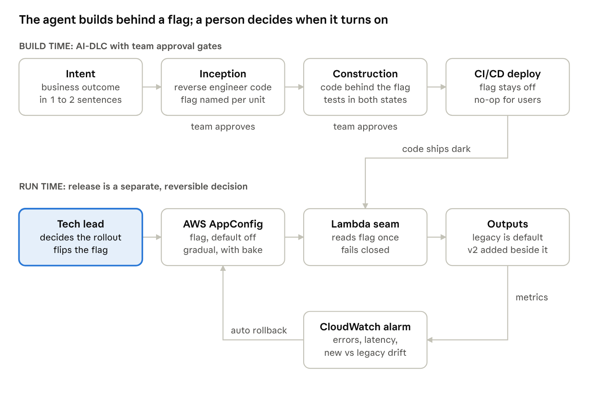

# AI-DLC Meets Brownfield: Shipping AI-Built Changes Without Breaking Production

*How I paired the AWS AI-Driven Development Lifecycle with AWS AppConfig feature flags to let an AI agent change a live production application without the existing users ever noticing, plus a project you can deploy to your own AWS account to see it work.*

## TL;DR

- **Greenfield demos are easy. Brownfield is where AI-driven development is really tested.** Real systems have undocumented behavior, downstream consumers and users who depend on today's output.
- **AI-DLC gives you human approval gates during design and construction.** It does not, by itself, give you one at the moment the change meets production traffic.
- **Feature flags close that gap.** I made "every behavior change ships dark behind a flag" a non-negotiable rule for the agent. Then I used AWS AppConfig deployment strategies and CloudWatch alarms so a person, not a deploy pipeline, decides when new behavior goes live, and an alarm can take it back automatically.
- Below: the architecture, a phase-by-phase playbook, the lessons I wish I had on day one, and the complete Support Ticket Priority project on GitHub. You can deploy it to your own AWS account with one command and watch AppConfig roll back a bad release for you.

## Why brownfield is the real test

Most AI-coding demos start from an empty repo. Most of our real work doesn't. Production applications carry years of business rules, downstream consumers and people who make decisions from their output every day. In that world, "move fast and break things" is not an option.

That context forces a different question than most AI-coding articles ask. The question is not *can an agent write this feature?* It usually can. The question is: **how do I let an agent change a system that real people rely on, and still be able to prove that nothing they depend on changed until we decided it should?**

My answer combines two things AWS already gives us: a methodology (AI-DLC) and a release-control primitive (AppConfig feature flags). Neither is new. The way they fit together is the point of this article.

## AI-DLC in 90 seconds

AI-DLC puts AI at the center of the lifecycle and keeps humans as the approvers. AWS introduced the [AI-Driven Development Lifecycle](https://aws.amazon.com/blogs/devops/ai-driven-development-life-cycle/) as a methodology, not a tool. The AI proposes plans, asks clarifying questions and generates artifacts. Humans validate, decide and own the outcome.

It runs in three phases:

1. **Inception**: turn intent into requirements, user stories and units of work. Teams validate the AI's questions and proposals together in a ritual called *Mob Elaboration*.
2. **Construction**: domain model, logical design, code and tests, again reviewed by the team (*Mob Construction*).
3. **Operations**: deployment, observability and running the change in production.

The workflow is open source as [awslabs/aidlc-workflows](https://github.com/awslabs/aidlc-workflows) under MIT-0. Version 2 is a native implementation with a deterministic engine and state tracking. It runs in Kiro (IDE and CLI), Claude Code, Codex CLI, Cursor, opencode and GitHub Copilot. Earlier versions shipped as plain rule files for Amazon Q Developer and others.

Two properties matter most for brownfield work:

- **It is adaptive.** The workflow detects whether the workspace is greenfield or brownfield, analyzes the existing code, and scales the rigor to the change. A small fix skips stages a new capability needs.
- **It leaves an audit trail.** Every plan, question, answer and approval is written to files in the repo. For a regulated domain, that record is worth as much as the code.

## The core idea: a human gate at the moment of truth

AI-DLC already gates the *plan* and the *code*. The gap is the *release*: the moment new behavior first meets real data and real users. A merged pull request is not a decision that users should see the change. In a brownfield system those two events must be separate.

Feature flags separate them. AWS AppConfig feature flags let you change behavior in production without a code deployment. They also add guardrails: validators on flag values, gradual [deployment strategies](https://docs.aws.amazon.com/appconfig/latest/userguide/what-is-appconfig.html), and [automatic rollback](https://docs.aws.amazon.com/appconfig/latest/userguide/monitoring-deployments.html) when a CloudWatch alarm fires during a deployment.

So the pattern is three rules:

1. **The agent may only add behavior behind a flag that defaults to off.** The legacy path stays the default and stays tested.
2. **Code deploys are boring.** With the flag off, a deployment must be a no-op for users. That is something you can test.
3. **Turning the flag on is a human decision**, rolled out gradually, watched by alarms, and reversible in seconds.

In AI-DLC terms, flipping the flag becomes the final approval gate, owned by the Operations phase.

## Reference architecture



The top row is AI-DLC as AWS ships it, with team approvals in Inception and Construction. The bottom row is what I added for brownfield: code reaches production dark, a person turns the flag on through AppConfig, and a CloudWatch alarm can turn it back off without waiting for anyone.

## The playbook, phase by phase

### Inception: make the agent learn the system before it changes it

1. **Start with a statement of intent, not a prompt essay.** One or two sentences on the business outcome. Let the workflow ask the questions.
2. **Let reverse engineering run, then correct it.** On a brownfield repo the agent builds a model of the existing code: components, data flows, dependencies. Review that model as a team. Every wrong assumption you catch here is a defect you never ship.
3. **Write down the behavior that must not change.** List the outputs, reports and integrations users depend on today. These become your regression contract and the "flag off" test suite.
4. **Name the flag in the requirements.** Each unit of work that changes behavior gets a flag name, an owner, a default of off and a planned removal date. Making the flag a requirement means the agent designs for it instead of bolting it on.

### Construction: build both paths, test both paths

1. **Branch at one seam.** Read the flag once, at the entry point of the unit, and route to the new or legacy implementation. Flag checks scattered across the codebase become impossible to remove later.
2. **Never mutate shared state in the new path until it is proven.** Where the new logic produces data, write it alongside the legacy result (a new attribute, column or table) rather than over it.
3. **Test the flag-off path as hard as the flag-on path.** The flag-off suite is the proof that the deployment is a no-op. Make it a required CI check.
4. **Review generated code in Mob Construction with the flag in mind.** Ask one question of every diff: *with the flag off, can this change what a user sees?*

### Operations: release is a separate, reversible decision

1. **Deploy code with the flag off.** Confirm that dashboards and the flag-off contract stay flat.
2. **Enable for internal users or a shadow comparison first.** Run new and legacy logic side by side and compare outputs before anyone acts on the new one.
3. **Roll out with an AppConfig deployment strategy.** Use a linear or exponential strategy with bake time. Attach CloudWatch alarms on error rate, latency and a business-level sanity metric to the AppConfig environment.
4. **Let the alarm be the first responder.** If an alarm fires during the deployment, AppConfig rolls the flag back to the previous version.
5. **Remove the flag.** Once the new behavior is the accepted default, delete the legacy path and the flag. A short-lived release flag that lives forever is technical debt.

## The code

To make this concrete, I built a small, generic use case you can run yourself: **Support Ticket Priority**. Today, a support platform sets every ticket's priority from the customer's tier alone, so an enterprise how-to question outranks a full outage for a standard customer. The new rule, built with AI-DLC, scores real impact instead: tier, whether the service is down, how many users are affected, and how long the ticket has been open. Support teams, dashboards and SLAs depend on today's priority, which makes it a textbook brownfield change.

Every snippet below is copied from the [Support Ticket Priority project](https://github.com/ckoredla/CK_Docs/tree/main/blog/ai-dlc-meets-brownfield), so what you read is exactly what you deploy. Three pieces make the pattern work: the AppConfig infrastructure, the flag read at runtime, and a rule that keeps the agent honest.

### 1. AppConfig flag, rollout strategies and alarm-based rollback (Terraform)

The infrastructure is plain Terraform with the AWS provider, so it fits whatever pipeline you already run, and it works unchanged with OpenTofu. This excerpt from [`terraform/appconfig.tf`](https://github.com/ckoredla/CK_Docs/blob/main/blog/ai-dlc-meets-brownfield/terraform/appconfig.tf) ships the flag off, tells the `prod` environment to watch two CloudWatch alarms, and defines one strategy for turning the flag on and another for turning it off.

```hcl
resource "aws_appconfig_configuration_profile" "flags" {
  application_id = aws_appconfig_application.flags.id
  name           = var.profile_name
  location_uri   = "hosted"
  type           = "AWS.AppConfig.FeatureFlags"
}

# Flags version 1: the new priority logic exists in code but is OFF.
# Later versions are created by scripts/rollout.py, which a person runs.
resource "aws_appconfig_hosted_configuration_version" "flags_off" {
  application_id           = aws_appconfig_application.flags.id
  configuration_profile_id = aws_appconfig_configuration_profile.flags.configuration_profile_id
  content_type             = "application/json"
  content                  = file("${path.module}/release-flags-v1.json")
  description              = "Initial version: new_priority_scoring off"
}

resource "aws_appconfig_environment" "prod" {
  application_id = aws_appconfig_application.flags.id
  name           = var.env_name

  # If either alarm fires during a flag deployment, AppConfig rolls it back.
  monitor {
    alarm_arn      = aws_cloudwatch_metric_alarm.function_errors.arn
    alarm_role_arn = aws_iam_role.appconfig_alarms.arn
  }

  monitor {
    alarm_arn      = aws_cloudwatch_metric_alarm.priority_disagreement.arn
    alarm_role_arn = aws_iam_role.appconfig_alarms.arn
  }
}

# Turning ON: 20% more Lambda execution environments every 4 minutes,
# then 10 minutes of bake time while the alarms watch.
resource "aws_appconfig_deployment_strategy" "gradual" {
  name                           = "${var.app_name}-linear-20pct-bake-10m"
  deployment_duration_in_minutes = 20
  growth_type                    = "LINEAR"
  growth_factor                  = 20
  final_bake_time_in_minutes     = 10
  replicate_to                   = "NONE"
}

# Turning OFF (kill switch): everyone at once, no bake.
resource "aws_appconfig_deployment_strategy" "immediate" {
  name                           = "${var.app_name}-immediate-no-bake"
  deployment_duration_in_minutes = 0
  growth_type                    = "LINEAR"
  growth_factor                  = 100
  final_bake_time_in_minutes     = 0
  replicate_to                   = "NONE"
}
```

The rest lives in `lambda.tf` (the function, its role and log group) and `alarms.tf` (the two alarms). When you copy this into your own Terraform, get three details right:

- **Terraform owns the infrastructure, people own the release.** Terraform creates flags version 1 with the flag off, and every later version comes from a person running `rollout.py`. Don't put the flag value in a Terraform variable, or a routine `terraform apply` quietly becomes a release.
- **The role AppConfig assumes needs `cloudwatch:DescribeAlarms`.** Without it, AppConfig can't see the alarms it's supposed to watch.
- **Alarm actions must be enabled on each alarm**, or [AppConfig will not roll back](https://docs.aws.amazon.com/appconfig/latest/userguide/monitoring-deployments.html).

### 2. Reading the flag at one seam (Python on AWS Lambda)

The function runs the AWS AppConfig Agent Lambda extension as a layer. In `lambda.tf`, an `aws_ssm_parameter` data source reads the latest layer ARN on every plan from the public SSM parameter `/aws/service/aws-appconfig/lambda-extension/x86/latest`, so you never hard-code a version. The extension polls AppConfig every 15 seconds and serves cached flags on `localhost:2772`, which means reading a flag costs a local HTTP call, not an AWS API call. Here is the reader from [`src/flags.py`](https://github.com/ckoredla/CK_Docs/blob/main/blog/ai-dlc-meets-brownfield/src/flags.py) and the seam from [`src/app.py`](https://github.com/ckoredla/CK_Docs/blob/main/blog/ai-dlc-meets-brownfield/src/app.py):

```python
# src/flags.py
def flag_enabled(flag: str) -> bool:
    """Return True only if AppConfig positively says the flag is enabled."""
    # Local-only override for running on your laptop, never set in AWS.
    override = os.environ.get("FLAGS_LOCAL_OVERRIDE")
    if override:
        try:
            return bool(json.loads(override).get(flag, False))
        except (ValueError, AttributeError):
            return False

    try:
        with urllib.request.urlopen(_flag_url(flag), timeout=TIMEOUT_SECONDS) as response:
            body = json.load(response)
        return body.get("enabled") is True
    except Exception:  # noqa: BLE001 - any failure must fall back to legacy
        return False


# src/app.py
def handler(event, context=None):
    try:
        ticket = Ticket.from_event(event)
    except InvalidTicket as exc:
        return {"error": str(exc)}

    legacy = score_legacy(ticket)

    if not flag_enabled(FLAG):
        return legacy  # flag off: byte-for-byte the behavior users have today

    v2 = score_v2(ticket)
    emit_metrics(V2Evaluated=1, PriorityDisagreement=1 if disagrees(legacy, v2) else 0)
    return {**legacy, "v2": v2}
```

Look at what keeps this safe. The flag is read in exactly one place. Any failure, including the extension not being there at all, means "off". The v2 result sits beside the legacy fields instead of replacing them. And every v2 evaluation emits a `PriorityDisagreement` metric through CloudWatch Embedded Metric Format, which is the business signal the second alarm watches. Copy those four habits and the rest is plumbing.

### 3. A rule that keeps the agent honest

AI-DLC lets you add your own rules to the ones it ships. I added a short team rule, kept in the repo next to the workflow's own rules, so every generated plan and diff follows it:

```markdown
# Brownfield release rule (team extension)

- Any change that alters user-visible behavior, outputs or stored data MUST be
  gated by an AWS AppConfig feature flag that defaults to disabled.
- Read the flag once, at the unit's entry point. Do not scatter flag checks.
- On flag-read failure, fall back to the legacy path.
- New outputs are additive. Never overwrite legacy fields while the flag exists.
- Every unit of work lists: flag name, owner, default, rollout plan, removal date.
- Tests MUST cover both flag states. The flag-off suite is a required CI check.
- Never change a flag value or deployment from the agent session.
  Flag rollouts are human decisions.
```

The last line matters most. The agent can write the flag; it never flips it.

## Deploy it in your own AWS account

Reading about a release gate is one thing. Watching an alarm pull a bad release back while you sit on your hands is what makes it stick. Everything below runs from the [Support Ticket Priority project](https://github.com/ckoredla/CK_Docs/tree/main/blog/ai-dlc-meets-brownfield), and every step is a `make` target, so you won't need to copy long commands. Plan on about an hour, most of it waiting for the gradual rollout.

**What you need:** Terraform 1.5 or later (or OpenTofu: add `TF=tofu` to every `make` command), Python 3.13, AWS CLI v2, GNU Make, and credentials for an AWS account you're allowed to experiment in. Terraform uses the same credentials as the AWS CLI, so run `aws sts get-caller-identity` first to see exactly which account you're deploying to. Everything goes to `us-east-1`. To use another Region, pass it to the commands that create and delete resources, for example `make deploy REGION=eu-west-1`; the other commands read the Region from `terraform output`.

**1. Clone, install and test.** You don't need an AWS account for this step.

```sh
git clone https://github.com/ckoredla/CK_Docs.git
cd CK_Docs/blog/ai-dlc-meets-brownfield
make setup
make test
```

`make setup` creates a Python virtual environment and runs `terraform init`. You should see `54 passed`. Five of those tests run the handler with the flag off: they prove a deploy changes nothing for current users, and that is the habit I most want you to take back to your own codebase. A few more parse the Terraform offline and fail if anyone ships the flag on or drops an alarm from the environment.

**2. Deploy with the flag off.**

```sh
make deploy
make invoke
```

`make deploy` runs `terraform apply`, which ends its plan with `Plan: 16 to add, 0 to change, 0 to destroy.` Read it, type `yes`, and Terraform creates the AppConfig resources, deploys flags version 1 with the flag off, and creates the function, its role and the two alarms. `make invoke` then sends `events/standard-customer-full-outage.json`, a standard-tier customer whose service is down for 250 users. You get the legacy answer only:

```json
{"ticket_id": "TCK-1001", "priority": "P3", "method": "legacy-customer-tier"}
```

The new code is in production and no user can tell. That's shipping dark.

**3. Be the human gate.**

```sh
make enable
```

This creates flags version 2 with the flag on and rolls it out with the gradual strategy: 20% more execution environments every 4 minutes, then 10 minutes of bake time with both alarms watching. The script prints the state and percentage every 20 seconds until it reaches `COMPLETE`. Run `make invoke` again and the response now carries a `v2` block beside the legacy fields:

```json
"v2": {"priority": "P1", "method": "v2-impact-score", "score": 7, "factors": {"tier": 1, "service_down": 3, "users_affected": 3}}
```

A full outage for 250 users sits in the `P3` queue today, and v2 moves it to `P1`. That disagreement is exactly what you want a person, and an alarm, watching during rollout. Try `make invoke EVENT=events/enterprise-how-to-question.json` to see the opposite case: legacy says `P1`, v2 says `P2`.

**4. Pull the kill switch.**

```sh
make disable
```

If a rollout is still running, the script stops it first and AppConfig reverts it. Then it deploys the flag as off with the `immediate-no-bake` strategy, and every execution environment picks that up at its next 15-second poll. Turning a flag on is gradual. Turning it off is immediate. Build that asymmetry into your own systems.

One AppConfig rule to know before you script your own rollouts: an environment runs one deployment at a time. That's why the kill switch has no bake time. A 10-minute bake on the way down, like the predefined `AppConfig.AllAtOnce` strategy has, would block your next rollout for those 10 minutes.

**5. Let the alarm do the rollback.**

```sh
make rollback-demo
```

This starts a fresh `enable` rollout, waits 60 seconds, then forces the `support-ticket-priority-priority-disagreement` alarm into `ALARM`. That's the same thing that happens when v2 starts moving too many tickets into a different queue. Within one poll you'll see the deployment end in `ROLLED_BACK`, and the flag is off again. Nobody had to be awake for that.

**6. Clean up.**

```sh
make destroy
```

This deletes the flag versions that `make enable` and `make disable` created (Terraform only knows about version 1), then runs `terraform destroy`. The project README has a troubleshooting table and a six-step guide for bringing the same seam, tests, alarms and agent rule into your own brownfield service.

## Lessons learned

**The reverse-engineering review is the highest-leverage meeting on a brownfield project.** The agent's model of a legacy system is confident and partly wrong. An hour spent correcting it saves far more time than any code review later.

**Write the "must not change" list before the agent writes any code.** Without it, "no regressions" is a feeling. With it, it is a test suite.

**Flags are a design input, not a deployment trick.** When the flag is named in the requirements, the agent designs one clean seam around it. When a flag is bolted on after code generation, the conditionals end up scattered across files.

**Gradual rollout in AppConfig is per configuration fetch, not per user.** A deployment strategy controls how fast the new flag value reaches the targets that poll for it. If you need a stable cohort of users, put targeting in the flag logic or use AppConfig's multi-variant features. Don't assume 20% of deploy means 20% of people.

**Alarm on the business, not only on the infrastructure.** Error rate and latency catch crashes. They do not catch a scoring change that is quietly wrong. A metric that compares new and legacy outputs is what makes automatic rollback meaningful.

**Keep the audit trail.** The AI-DLC record of questions, answers and approvals, plus the AppConfig deployment history, tells a reviewer exactly who decided what and when. In a regulated industry that is a requirement, not a nice-to-have.

### Anti-patterns to avoid

| Anti-pattern | Why it hurts | Do this instead |
| --- | --- | --- |
| Agent edits legacy code in place, no flag | Every deploy is a release; no fast way back | Flag-first rule in the agent's instructions |
| Flag checks in many files | Flag can never be removed safely | One seam per unit of work |
| New logic overwrites stored fields | Rollback of the flag cannot roll back the data | Additive outputs until the flag is retired |
| Only flag-on tests | You cannot prove the deploy was a no-op | Flag-off suite as a required check |
| Agent session can deploy config | Removes the human gate the pattern exists for | Separate IAM; rollout is a human action |
| Flags that never die | Two code paths forever | Removal date in the requirement |

## Your brownfield AI-DLC checklist

- [ ] Statement of intent written in business terms
- [ ] Agent's reverse-engineered model reviewed and corrected by the team
- [ ] "Must not change" behavior listed and turned into tests
- [ ] Flag name, owner, default (off) and removal date in each unit of work
- [ ] Flag-first release rule added to the agent's instructions
- [ ] One flag seam per unit; fail-closed flag read
- [ ] New outputs additive, not overwriting
- [ ] Flag-off and flag-on suites both required in CI
- [ ] AppConfig environment monitors a CloudWatch alarm that includes a business metric
- [ ] Gradual deployment strategy with bake time
- [ ] Agent credentials cannot change flag values
- [ ] Flag and legacy path removed after acceptance

## Closing thoughts

AI-DLC changes who writes the code. It should not change who decides what users experience. In a brownfield system, the cleanest way I have found to keep that line sharp is simple: the agent builds behind a flag, and people decide when the flag turns on.

If you are running AI-DLC on legacy code, I would like to hear how you handle the release gate. Share your approach in the comments, or reach out to compare notes.

In the next article I will go deeper into the Operations phase: designing the comparison metrics that make automatic rollback trustworthy for AI-generated logic.

## References

- [AI-Driven Development Life Cycle: Reimagining Software Engineering](https://aws.amazon.com/blogs/devops/ai-driven-development-life-cycle/), AWS DevOps Blog
- [Open-Sourcing Adaptive Workflows for AI-DLC](https://aws.amazon.com/blogs/devops/open-sourcing-adaptive-workflows-for-ai-driven-development-life-cycle-ai-dlc), AWS DevOps Blog
- [awslabs/aidlc-workflows](https://github.com/awslabs/aidlc-workflows) and its [documentation](https://awslabs.github.io/aidlc-workflows/)
- [What is AWS AppConfig?](https://docs.aws.amazon.com/appconfig/latest/userguide/what-is-appconfig.html), AWS documentation
- [Monitoring deployments for automatic rollback](https://docs.aws.amazon.com/appconfig/latest/userguide/monitoring-deployments.html), AWS documentation
- [Implementing dynamic feature flags with AWS AppConfig on AWS Lambda](https://aws.amazon.com/blogs/compute/implementing-dynamic-feature-flags-with-aws-appconfig-on-aws-lambda/), AWS Compute Blog
- [AWS provider for Terraform: AppConfig resources](https://registry.terraform.io/providers/hashicorp/aws/latest/docs/resources/appconfig_environment), Terraform Registry

*Opinions are my own and do not represent my employer. The use case and code in this article are generic examples and do not describe any employer's systems.*

**Tags:** #AWS #AIDLC #GenerativeAI #AppConfig #FeatureFlags #Terraform #Architecture #AWSCommunityBuilders
